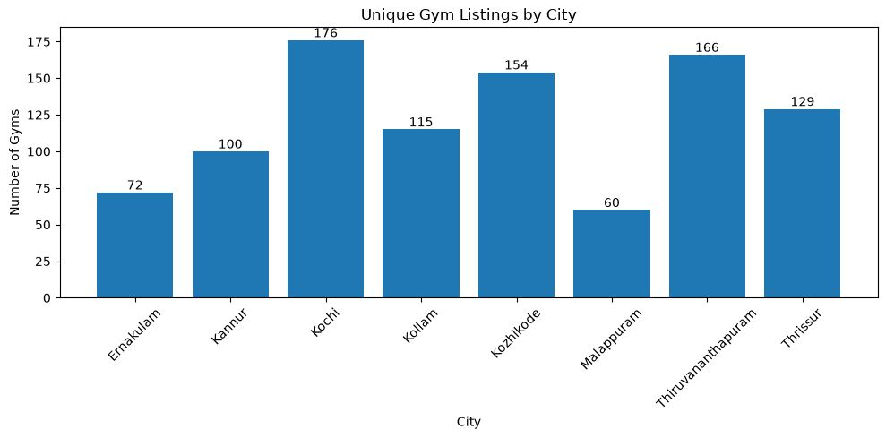
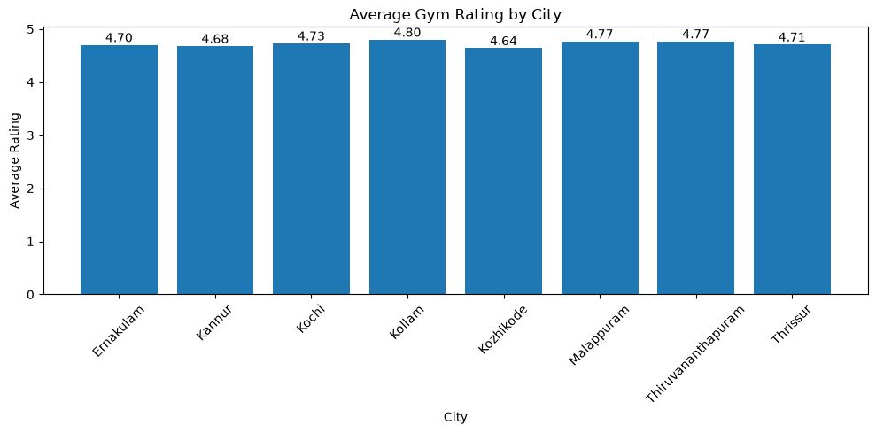
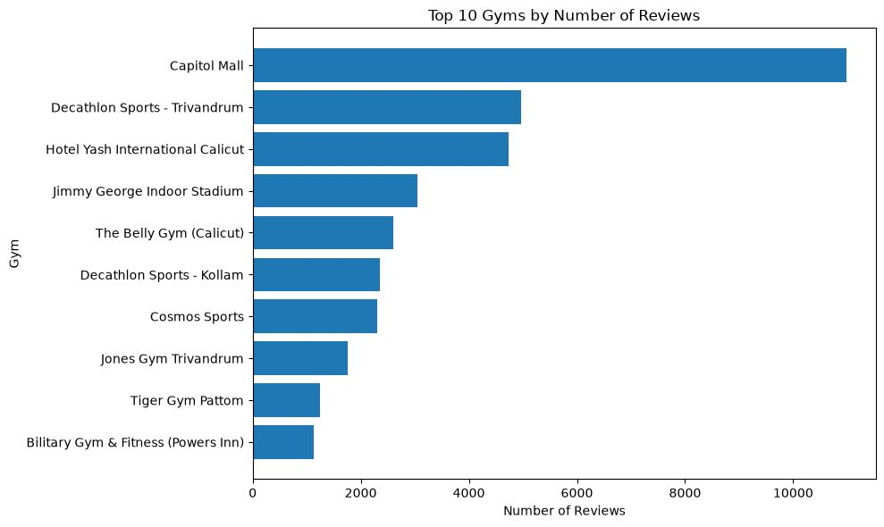

# Kerala Gyms Data Collection & ETL (Python)

A paginated API pipeline that collects gym listings across **8 Kerala cities** via the Google Maps API (SerpApi), then cleans, deduplicates and profiles the data before analysis.

## Pipeline

1. **Collect**: 64 paginated API requests across Ernakulam, Kannur, Kochi, Kollam, Kozhikode, Malappuram, Thiruvananthapuram and Thrissur
2. **Clean**: 1,190 raw records deduplicated to **972 unique listings**
3. **Profile**: data-quality profiling in Pandas (for example, 64% of listings had no website, 620 of 972)
4. **Analyse**: city-level analysis of gym supply and engagement in Matplotlib

## Findings

- Kochi has the most unique gym listings (176), Malappuram the fewest (60)
- Review counts are heavily concentrated: the top listing crosses 10,000 reviews (Capitol Mall, Kannur, 10,982) while most sit far below

## Tools

Python (Pandas, SerpApi, Matplotlib), Jupyter Notebook

## What it demonstrates

Real-world API data collection with pagination and deduplication, honest data-quality profiling, and exploratory analysis that answers a concrete question.
